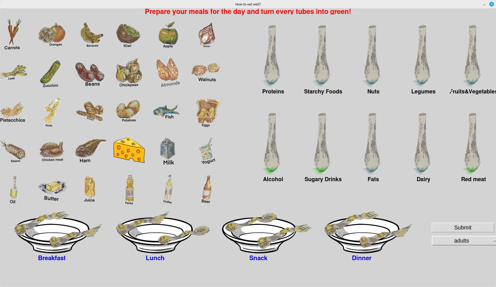
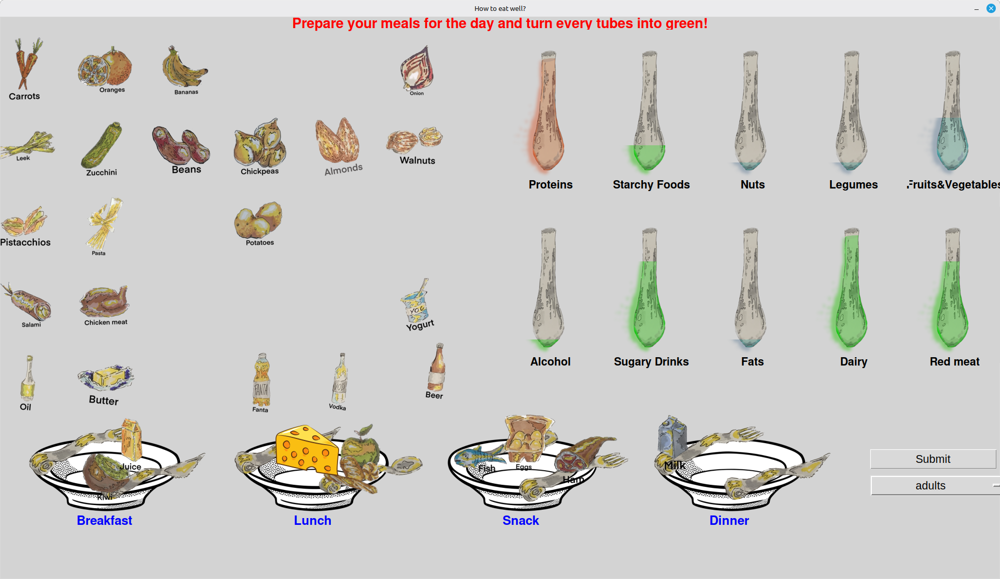
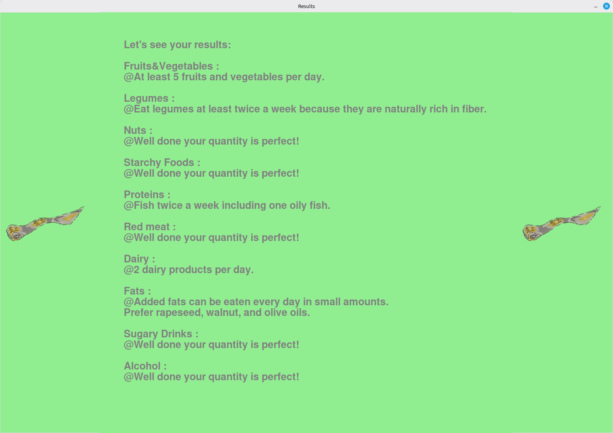

# Healthy Eating Game

An interactive drag-and-drop game that teaches in a pedagogic way how to follow the nutritional recommandations

## About

Healthy Eating Game was originally built for the European Day event in Warsaw to raise public awareness about nutrition in a playful, accessible way.

Instead of reading charts and guidelines, players drag and drop food items onto plates for Breakfast, Lunch, Snack and Dinner. Ten nutrition tubes react in real time:

- **Green** — your quantity matches the recommendations
- **Blue** — not enough of this category
- **Red** — too much of this category

At the end, a personalized report tells each player what they did well and what to improve, based on official dietary recommendations.

## How to Play

1. Pick your age group (4–6, 7–11, 12–17, adults, 75+) — recommendations adapt automatically
2. Drag food items onto the right plate for each of the 4 meals
3. Watch the tubes change color as you go
4. Hit Submit to get your personalized nutrition report

### Prerequisites

- Python 3.10+

## License

Distributed under the MIT License — see `LICENSE` for details.

## Acknowledgments

- Dietary recommendations given by www.mangerbouger.fr official national nutrition program of France
